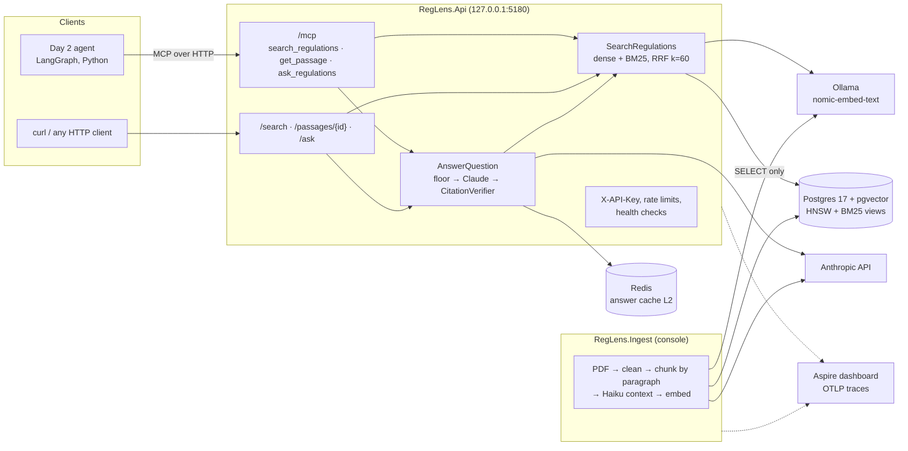

# RegLens

RegLens answers questions about Indian NBFC regulation with **citations that are checked word for word against the
source**. When the regulations don't answer a question, it says what is missing instead of guessing. It measures its own
retrieval and answer quality, and it exposes itself as an **MCP server** so agents can use it as a tool.

.NET 10 · ASP.NET Core minimal APIs · Postgres 17 + pgvector · Ollama `nomic-embed-text` · Claude (`claude-sonnet-5-5`
answers, `claude-haiku-5-5` chunk context, `claude-haiku-4-5` eval judge) · MCP C# SDK · OpenTelemetry

## The problem

Compliance teams at NBFCs (non-bank lenders) work from long RBI Directions and the DPDP Rules. A chatbot that sounds
confident but cites the wrong paragraph is worse than no answer. RegLens is built around three rules:

1. **Every quote is verified in code.** A citation survives only if its passage was retrieved for this question and
   its quote appears in that passage (normalised substring). If no citation survives, the answer becomes an abstention.
2. **"Not found" is an answer.** RegLens abstains without calling the model when nothing retrieved is close enough
   (a similarity floor set from data), and Claude abstains when the passages don't answer the question.
3. **Retrieved text is data, not instructions** (OWASP LLM01). Passages go to the model as escaped data, and a
   prompt-injection probe checks this.

## Corpus

Five official PDFs, verified by size and SHA-256 against `corpus/manifest.json` before anything is written:

- RBI (NBFCs – Know Your Customer) Directions, 2025
- RBI (NBFCs – Credit Facilities) Directions, 2025 (Chapter III: Digital Lending)
- RBI (NBFCs – Responsible Business Conduct) Directions, 2025 (KFS, penal charges, recovery)
- Digital Personal Data Protection Rules, 2025 (G.S.R. 846(E), English pages)
- The corrigendum to the DPDP Rules (G.S.R. 892(E))

## Architecture



The code follows clean architecture: `Domain` ← `Application` ← `Infrastructure` ← hosts (`Api`, `Ingest`, `Evals`).
Architecture tests enforce it. Model boundaries:
- Ollama only makes vectors.
- Anthropic only reads and writes text.
- Postgres never calls a model.

How a question is answered:
1. The question is embedded (`search_query:` prefix).
2. pgvector returns the top 40 and BM25 (computed in SQL) another 40; the two lists are fused with RRF.
3. Paragraph citations in the question ("Rule 7", "para 29") are looked up exactly and pinned first.
4. If nothing is close enough, RegLens abstains. Otherwise the top 8 passages go to Claude with a JSON schema.
5. The code verifier drops any citation whose quote isn't in its passage.
6. The result is cached in HybridCache (memory, then Redis), keyed by the question and the index version.

Contextual retrieval: at ingest, `claude-haiku-5-5` writes a short context for each chunk, with the whole document
in the prompt cache (98% of input tokens were cache reads). The context is embedded and keyword-indexed, but it is
never sent to the answer model.

## Results

From `evals/results.md`, golden set `evals/golden-set.json`: 20 answerable questions and 10 that the corpus can't
answer, reviewed by the owner. With n = 20, one question moves recall by 0.05.

**Retrieval** (no LLM, n = 20). Stage 1: first chunker, no context (2026-11-23). Stage 3: fixed chunker with Haiku
chunk context (2026-11-24).

| Configuration | recall@5 | recall@8 | MRR@10 |
|---------------|----------|----------|--------|
| hybrid-bm25 (default), stage 1 | 0.85 | 0.85 | 0.772 |
| **hybrid-bm25 (default), stage 3** | **0.90** | **0.95** | **0.907** |
| dense only, stage 3 | 0.95 | 1.00 | 0.931 |
| keyword BM25 only, stage 3 | 0.85 | 0.90 | 0.768 |

**Answers** (hybrid-bm25, stage 3, `claude-sonnet-5-5` effort medium, floor 0.63, n = 30, 2026-11-24):

| Metric | Result |
|--------|--------|
| Abstained on unanswerable questions | 10/10 |
| Wrongly abstained on answerable questions | 0/20 (stage 1: 2/20) |
| Answered and cited an expected paragraph | 19/20 |
| Citations dropped by the verifier | 0 |
| Groundedness / relevance, `claude-haiku-4-5` judge, 1–5 | 4.90 / 4.45 (n = 20) |
| Cost of the 30-question run (answers and judge) | $0.557 |
| p50 latency of a model-calling answer | 3.6 s |

One traced uncached `/ask` took 3.49 s: Sonnet 2.84 s, embedding 0.14 s, SQL about 50 ms (spec 0006). A
prompt-injection probe (a passage that tells the model to cite a canary) passed.

## Quickstart (Windows, PowerShell)

You need: .NET SDK 10.0.404+, Docker Desktop, [Ollama](https://ollama.com), and an Anthropic API key in the
`ANTHROPIC_API_KEY` environment variable.

```powershell
git clone https://github.com/Akus0ni/reglens; cd reglens
docker compose up -d                       # Postgres+pgvector, Redis, Aspire dashboard (all on 127.0.0.1)
ollama pull nomic-embed-text
dotnet build RegLens.slnx
dotnet test                                # needs Docker (Testcontainers); no API calls

# Ingest: migrations, then all five PDFs. Chunk context costs about $0.27 once, then it is cached in Postgres.
dotnet user-secrets set "ConnectionStrings:RegLens" "Host=127.0.0.1;Port=5432;Database=reglens;Username=reglens;Password=reglens-dev" --project src/RegLens.Ingest
dotnet run --project src/RegLens.Ingest    # free alternative: $env:Context__Enabled='false' first

# The API connects as a SELECT-only login and needs an API key.
$env:REGLENS_API_DB_PASSWORD = '<choose a password>'; ./scripts/create-api-db-user.ps1
dotnet user-secrets set "ConnectionStrings:RegLens" "Host=127.0.0.1;Port=5432;Database=reglens;Username=reglens_api;Password=<that password>" --project src/RegLens.Api
dotnet user-secrets set "Auth:ApiKey" "<32 or more random characters>" --project src/RegLens.Api
dotnet run --project src/RegLens.Api       # http://127.0.0.1:5180

curl http://127.0.0.1:5180/health/ready
curl -H "X-API-Key: <key>" "http://127.0.0.1:5180/search?q=Rule%207&topK=5"
curl -X POST http://127.0.0.1:5180/ask -H "X-API-Key: <key>" -H "Content-Type: application/json" `
     -d '{"question":"When must a personal data breach be reported to the Board?"}'
```

**MCP:** point any MCP client at `http://127.0.0.1:5180/mcp` (Streamable HTTP, stateless) with the `X-API-Key`
header. `scripts/mcp-check.cs` is a minimal .NET client (`dotnet run scripts/mcp-check.cs -- list`).

**Traces:** open the Aspire dashboard at http://localhost:18888. The login link is in
`docker logs reglens-aspire-dashboard-1`.

**Evals:** `dotnet run --project src/RegLens.Evals -- retrieval --config hybrid-bm25` is free. The answer eval needs
`--confirm-spend` and costs about $0.56.

## Production basics

- An API key in `X-API-Key`, compared in constant time. Every endpoint except `/health/*` requires it, and the API
  won't start without a key.
- Per-caller rate limits shared by REST and MCP: 5 asks and 30 reads a minute. REST returns 429 with `Retry-After`.
- `/health/live` and `/health/ready`. Postgres or Ollama down is Unhealthy; Redis down is Degraded.
- The API's Postgres login can only SELECT (migration 005). Host filtering allows loopback only.
- Retries, timeouts and a circuit breaker around Ollama. The Anthropic SDK has its own retries, and outages map to
  503.
- OpenTelemetry from both hosts: HTTP, SQL, embedding and GenAI spans with token counts.

## Known limitations

- **Small golden set.** 20 answerable questions; differences of one question are not evidence. Dense-only search
  scores slightly higher than the hybrid default at stage 3 (one question at recall@5). The default stays hybrid until
  there is a larger set (D56).
- **One retrieval miss remains.** cf-05 asks about a "lending service provider", while the Directions mostly say
  "LSP". The right passage ranks 17th.
- **Generated contexts can be wrong.** In 2 of 512 chunk contexts, the DPDP Rules are placed in chapters they don't
  have. Contexts only affect retrieval, never answers (D57).
- **Judge check.** The hand check of the eval judge (10/10 within one point) was done by another Claude model at the
  owner's request, not by a person.
- **Scope.** Five documents, NBFC scope, English pages only. RBI updates Directions in place, so the corpus is a
  snapshot (dates in `corpus/manifest.json`).
- **Local only.** One shared API key, no OAuth, bound to 127.0.0.1, run and tested on Windows. Traces include prompt
  and answer text by default (`Telemetry:CaptureContent`).
- **Cold start.** The first embedding after Ollama unloads the model takes about 30 s.

## How it was built

Spec first: every feature has a spec (`docs/specs/`) merged through its own PR before any code, with numbered
requirements, acceptance checks and primary sources. Decisions and open questions are in `docs/plan.md`, history in
`docs/project-log.md`, and eval runs in `evals/`.

| Spec | Feature |
|------|---------|
| [0001](docs/specs/0001-ingest.md) | Ingestion: manifest check, PDF extraction, paragraph chunking, embeddings |
| [0002](docs/specs/0002-hybrid-retrieval.md) | Hybrid retrieval with RRF, `GET /search` |
| [0003](docs/specs/0003-answers.md) | Answers with verified citations, abstention, answer cache, `POST /ask` |
| [0004](docs/specs/0004-evals.md) | Golden set, eval runner, BM25, a floor set from data |
| [0005](docs/specs/0005-contextual-retrieval.md) | Contextual retrieval and heading fixes, measured in three stages |
| [0006](docs/specs/0006-mcp-production.md) | MCP server, API key, rate limits, health, tracing, read-only DB login |
